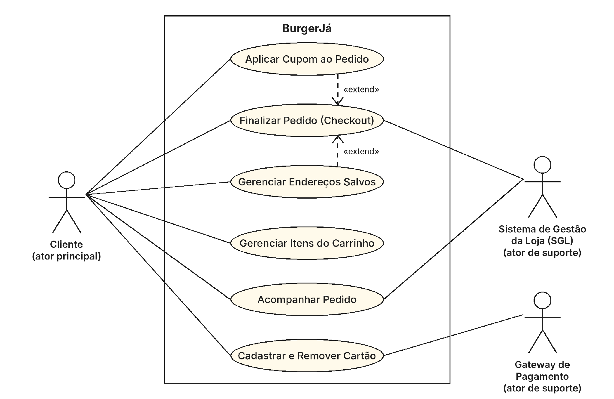
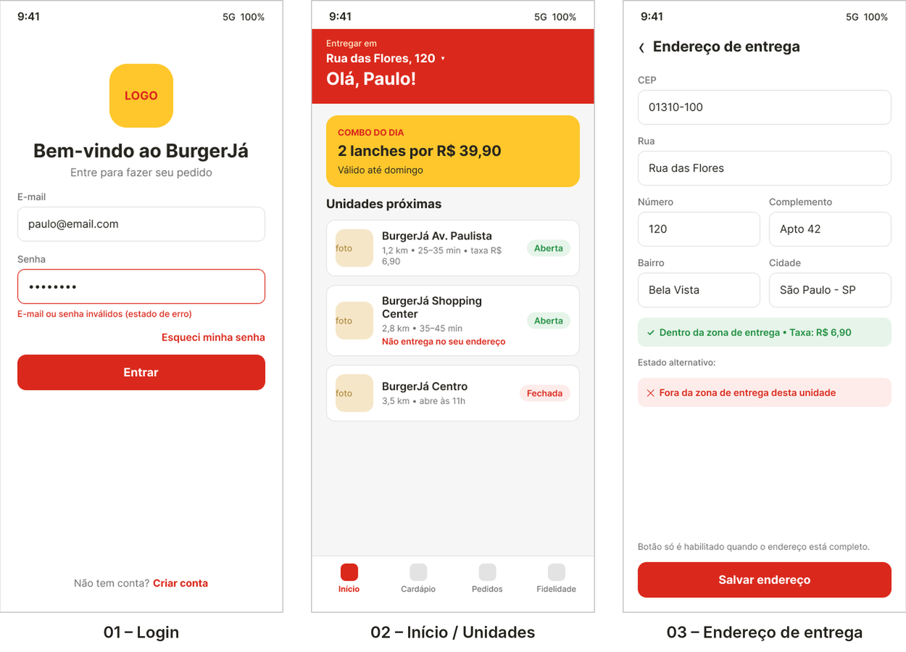
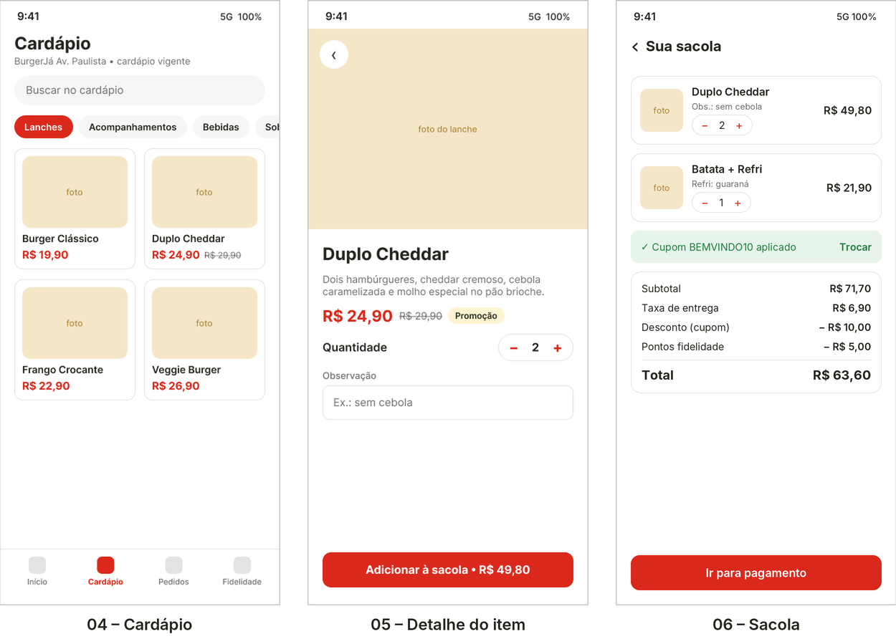
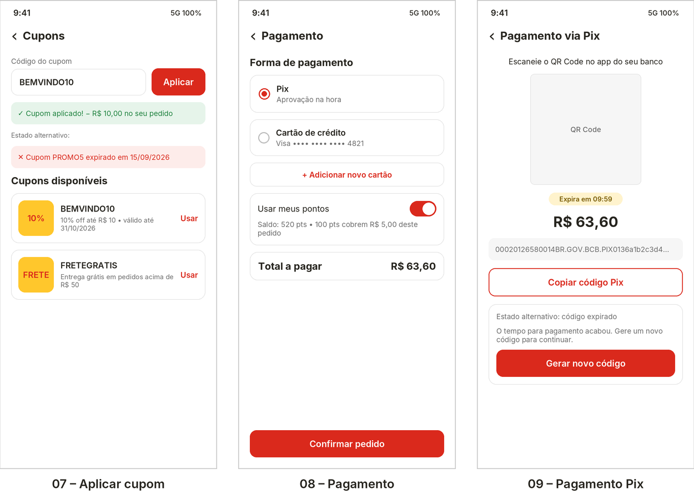
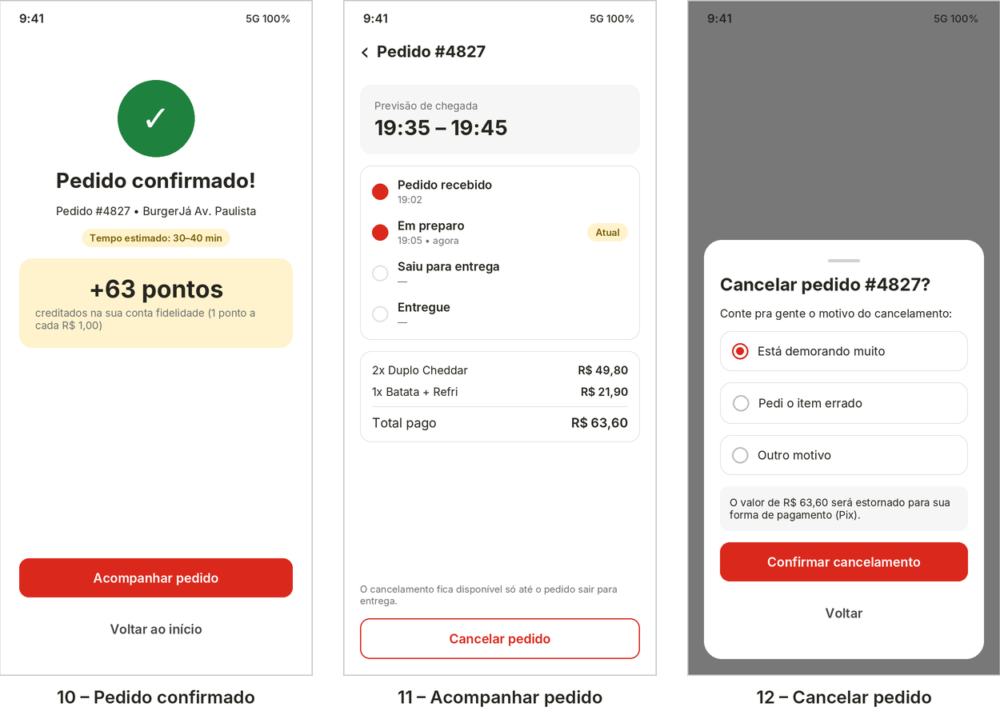
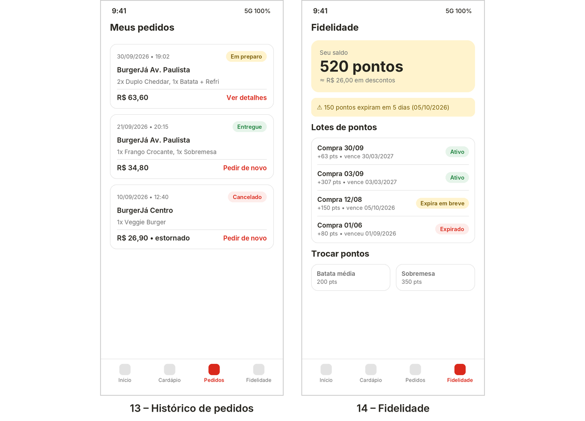
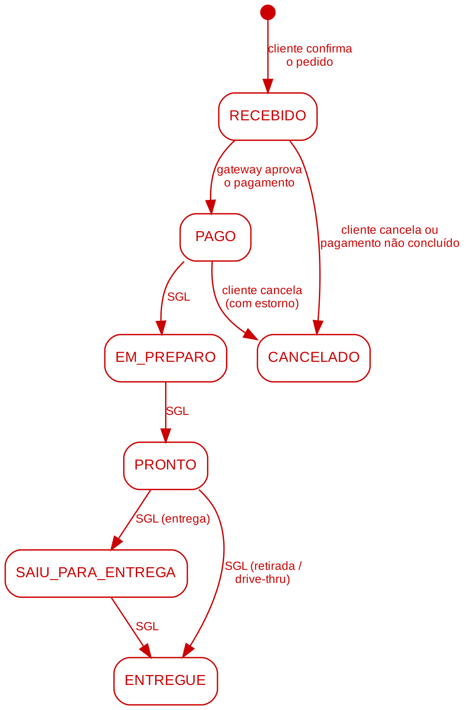

**Versão 1.0 aprovada**

**Elaborado por Lucas Ebrenz, Matheus Figueiredo, João Pedro Feijoo,
Paulo Henrique Monção, Hugo Freires e João Marcelo Onofre**

**PUC-RIO \| Engenharia de Requisitos 2026.2**

**Sumário**

**Sumário ii**

**Histórico de Revisões ii**

**1. Introdução 1**

> 1.1 Propósito 1
>
> 1.2 Convenções do Documento 1
>
> 1.3 Público-Alvo e Sugestões de Leitura 1
>
> 1.4 Escopo do Produto 2
>
> 1.5 Referências 2

**2. Descrição Geral 2**

> 2.1 Perspectiva do Produto 2
>
> 2.2 Funções do Produto 3
>
> 2.3 Classes de Usuários e Características 4
>
> 2.4 Ambiente Operacional 5
>
> 2.5 Restrições de Projeto e Implementação 5
>
> 2.6 Documentação para o Usuário 5
>
> 2.7 Premissas e Dependências 5

**3. Requisitos de Interface Externa 5**

> 3.1 Interfaces de Usuário 5
>
> 3.2 Interfaces de Hardware 10
>
> 3.3 Interfaces de Software 10
>
> 3.4 Interfaces de Comunicação 11

**4. Funcionalidades do Sistema 11**

> 4.1 “Finalizar pedido” 11
>
> 4.2 “Gerenciar Itens do Carrinho” 12
>
> 4.3 “Aplicar Cupom ao Pedido” 13
>
> 4.4 “Acompanhar Pedido” 13
>
> 4.5 “Cadastrar e Remover Cartão” 14
>
> 4.6 “Gerenciar Endereços Salvos” 15

**5. Outros Requisitos Não Funcionais 15**

> 5.1 Requisitos de Desempenho 15
>
> 5.2 Requisitos de Proteção (Safety) 16
>
> 5.3 Requisitos de Segurança (Security) 16
>
> 5.4 Atributos de Qualidade de Software 17
>
> 5.5 Regras de Negócio 18

**6. Outros Requisitos 18**

**Apêndice A: Glossário 18**

**Apêndice B: Modelos de Análise 18**

**Apêndice C: Lista de Itens a Definir 18**

**Histórico de Revisões**

| **Nome**             | **Data**   | **Motivo das Alterações**                                       | **Versão** |
|----------------------|------------|-----------------------------------------------------------------|------------|
| Lucas Ebrenz         |            | Versão inicial do documento a partir do modelo de ERS           | v0.0.1     |
| Matheus Figueiredo   | 24/10/2026 | Revisão do escopo e integração com API externa                  | v0.0.2     |
| Hugo Freires         | 27/10/2026 |                                                                 | v0.0.3     |
| Lucas Ebrenz         | 29/10/2026 | Casos de uso                                                    | v0.0.4     |
| Lucas Ebrenz         | 30/10/2026 | Casos de uso                                                    | v0.0.5     |
| Paulo e Feijoo       | 11/11/2026 | Mudanças pedidas pelo professor                                 | v0.0.6     |
| Paulo e João Marcelo | 13/11/2026 | Preenchimento da Seção 5.5, da Seção 6 e dos Apêndices A, B e C | v0.0.7     |
| Matheus              | 17/11/2026 | Revisão antes da entrega                                        | v0.0.8     |

# Introdução

## Propósito

Este documento especifica os requisitos de software da versão 1.0 do
BurguerJá, um sistema de pedidos pelo celular para uma rede de fast-food
inspirada no McDonald’s. Pelo aplicativo, os clientes podem consultar o
cardápio, fazer pedidos, pagar e gerenciar seus pontos do programa de
fidelidade. Esta ERS abrange todo o aplicativo voltado ao cliente e
detalha os requisitos funcionais e não funcionais necessários para a
jornada do usuário, do login à entrega do pedido.

## Convenções do Documento

**Modelo.** Este documento segue o modelo de especificação de requisitos
de Wiegers \[2\], baseado na norma IEEE 830 \[1\].

**Identificação dos requisitos.** Cada requisito tem um identificador
único conforme o seu tipo. Os requisitos funcionais recebem o rótulo
RF-XX (por exemplo, RF-01, RF-02) e estão descritos na Seção 4. Os
requisitos não funcionais recebem o rótulo RNF-XX (por exemplo, RNF-01,
RNF-02) e estão descritos na Seção 5. Os identificadores são numerados
em sequência dentro de cada tipo e não são reutilizados quando um
requisito é removido.

**Prioridade.** Cada requisito tem sua própria prioridade, que não é
herdada da funcionalidade a que pertence. As prioridades vão de 1 (mais
baixa) a 9 (mais alta).

**Informações pendentes.** A marcação TBD (To Be Determined, a definir)
indica uma informação que ainda não está disponível. Todos os itens TBD
estão listados no Apêndice C.

**Terminologia.** Termos técnicos, siglas e abreviações usados neste
documento estão definidos no Apêndice A.

## Público-Alvo e Sugestões de Leitura

Este documento se destina a dois grupos de leitores: o professor da
disciplina de Engenharia de Requisitos da PUC-Rio (2026.2), que avaliará
a especificação, e os desenvolvedores responsáveis pela implementação do
sistema, que a usarão como base para o projeto e a codificação.

O documento está organizado da seguinte forma. A Seção 1 apresenta o
documento, seu propósito, convenções e escopo. A Seção 2 traz uma
descrição geral do produto, incluindo suas principais funções, classes
de usuários, ambiente operacional, restrições e premissas. A Seção 3
descreve as interfaces externas do sistema: de usuário, de hardware, de
software e de comunicação. A Seção 4 detalha os requisitos funcionais,
organizados por funcionalidade do sistema. A Seção 5 apresenta os
requisitos não funcionais. A Seção 6 trata de outros requisitos.

Recomenda-se a todos os leitores ler o documento na ordem, começando
pelas Seções 1 e 2 para uma visão geral do produto antes de passar aos
requisitos detalhados das Seções 3 a 6.

## Escopo do Produto

O BurguerJá é um aplicativo de pedidos para uma rede de fast-food. Pelo
aplicativo, os clientes podem consultar o cardápio, fazer pedidos
escolhendo entre entrega e retirada na loja, pagar on-line (por Pix,
cartão de crédito ou pontos de fidelidade) e aproveitar os benefícios do
programa de fidelidade e os cupons promocionais.

O principal objetivo do sistema é oferecer aos clientes um canal digital
de pedidos simples e de autoatendimento. O escopo é focado de propósito
na experiência do usuário final (cliente) e cobre o fluxo que vai da
criação do carrinho ao acompanhamento do pedido. A gestão das lojas e a
atualização do cardápio estão fora deste escopo e ficam a cargo de um
Sistema de Gestão da Loja externo e hipotético.

## Referências

\[1\] IEEE Std 830-1998, IEEE Recommended Practice for Software
Requirements Specifications. Institute of Electrical and Electronics
Engineers, 1998.

\[2\] Wiegers, K. E. Software Requirements Specification Template. 1999.

\[3\] BurguerJá – Wireframes. Lucas Ebrenz, Matheus Figueiredo, João
Pedro Feijoo, Paulo Henrique Monção, Hugo Freires e João Marcelo Onofre.
Versão 1.0, outubro de 2026. Disponível em:
[<u>https://www.figma.com/design/SjbYOVnhJAb9HbL9kJoDHe/Projeto-de-Telas---BurguerJá</u>](https://www.figma.com/design/SjbYOVnhJAb9HbL9kJoDHe/Projeto-de-Telas---BurgerJ%C3%A1)

\[4\] Brasil. Lei nº 13.709, de 14 de agosto de 2018. Lei Geral de
Proteção de Dados Pessoais (LGPD). Disponível em:
https://www.planalto.gov.br/ccivil_03/\_ato2015-2018/2018/lei/l13709.htm

\[5\] Brasil. Lei nº 8.078, de 11 de setembro de 1990. Código de Defesa
do Consumidor. Disponível em:
https://www.planalto.gov.br/ccivil_03/leis/l8078compilado.htm

# Descrição Geral

## Perspectiva do Produto

O BurguerJá é um produto novo e independente, desenvolvido como projeto
acadêmico da disciplina de Engenharia de Requisitos da PUC-Rio. Ele se
inspira na experiência de pedidos do McDonald’s, mas não tem vínculo com
o McDonald’s e não substitui nem amplia nenhum sistema existente. Sua
principal motivação é aplicar os conceitos de elicitação, análise e
especificação de requisitos estudados na disciplina.

O sistema funciona como interface e motor de pedidos. Ele depende de
sistemas externos para completar o ciclo de vida de um pedido: um
Gateway de Pagamento, que processa as transações financeiras, e um
Sistema de Gestão da Loja (SGL), que recebe os pedidos feitos e envia as
atualizações de status de forma assíncrona.

## Funções do Produto

As principais funções do sistema estão resumidas abaixo. Os requisitos
detalhados de cada função estão na Seção 4.

- Criar uma conta e entrar no sistema.

- Escolher a modalidade do pedido (entrega ou retirada) e validar o
  endereço de entrega em relação às zonas de cobertura.

- Consultar o cardápio da loja escolhida e ver os detalhes dos itens
  (dados obtidos do SGL).

- Gerenciar o carrinho e aplicar cupons promocionais.

- Processar pagamentos por Pix, cartão de crédito ou pontos de
  fidelidade.

- Enviar os pedidos confirmados ao Sistema de Gestão da Loja externo.

- Acompanhar o status dos pedidos ativos em tempo real (por meio de
  webhooks do SGL).

- Cancelar pedidos (quando o status atual permitir) e consultar o
  histórico de pedidos.

- Acompanhar o saldo de pontos de fidelidade e os lotes que vão
  expirar.\]

Casos de uso:

- Finalizar Pedido (Checkout) (UC28), descrito na Seção 4.1.

- Gerenciar Itens do Carrinho (UC29), descrito na Seção 4.2.

- Aplicar Cupom ao Pedido (UC30), descrito na Seção 4.3.

- Acompanhar Pedido (UC31), descrito na Seção 4.4.

- Cadastrar e Remover Cartão (UC32), descrito na Seção 4.5.

- Gerenciar Endereços Salvos (UC33), descrito na Seção 4.6.

A Figura 1 mostra esses seis casos de uso e os atores descritos na Seção
2.3. Aplicar Cupom ao Pedido e Gerenciar Endereços Salvos estendem
Finalizar Pedido: o cliente pode aplicar um cupom ou cadastrar um novo
endereço durante o checkout, além de poder fazer isso de forma
independente.

*Figura 1. Diagrama de casos de uso do BurguerJá*

## Classes de Usuários e Características

O sistema interage com um ator principal e dois sistemas externos de
suporte:

**Cliente (ator principal):** os clientes são os únicos usuários
modelados dentro da fronteira do sistema. Eles usam o sistema para fazer
e acompanhar seus pedidos. Não se pressupõe nenhum conhecimento técnico,
por isso a interface deve ser simples e intuitiva. Os clientes podem ver
o cardápio das lojas, aplicar cupons, salvar endereços e cartões e
gerenciar sua participação no programa de fidelidade.

**Gateway de Pagamento (ator de suporte):** sistema externo automatizado
responsável por validar e capturar com segurança as transações
financeiras (cartão de crédito e Pix) antes de o BurguerJá confirmar um
pedido.

**Sistema de Gestão da Loja – SGL (ator de suporte):** sistema externo e
hipotético usado pelas lojas físicas. É responsável por fornecer o
cardápio atualizado e por receber os novos pedidos feitos pelo
BurguerJá. O SGL cuida do preparo e da entrega e chama a API do
BurguerJá de forma assíncrona sempre que um pedido muda de status (por
exemplo, de "Em preparo" para "Saiu para entrega").

## Ambiente Operacional

O sistema é acessado por um navegador web e deve ter um layout
responsivo, que se adapte tanto a computadores quanto a celulares,
priorizando a experiência no celular. A interface do usuário é escrita
em português do Brasil.

## Restrições de Projeto e Implementação

O banco de dados deve seguir o Modelo Relacional definido, implementando
restrições como a lógica XOR na associação de itens ao carrinho ou ao
pedido, gatilhos (triggers) para o cálculo dos pontos de fidelidade e
herança Table-Per-Type para as formas de pagamento (Pix, Cartão,
Pontos). Funções administrativas e de gestão da cozinha não devem ser
modeladas neste banco, pois pertencem ao SGL externo.

**Tecnologias de implementação.** O front-end é desenvolvido em
TypeScript com a biblioteca React e roda em navegadores web comuns
(recomenda-se o Google Chrome). O back-end é desenvolvido em Python com
o framework FastAPI e oferece uma API REST em JSON ao front-end. Os
dados persistentes ficam em um banco de dados relacional SQLite,
acessado apenas pelo back-end.

## Documentação para o Usuário

Não há um manual do usuário separado. A interface foi pensada para ser
autoexplicativa, com mensagens de erro junto aos campos e retorno
contextual (por exemplo, avisos visuais quando o endereço de entrega
está fora da área atendida ou quando um cupom é inválido).

## Premissas e Dependências

Pressupõe-se que os usuários tenham uma conexão estável com a internet
para consultar o cardápio e receber em tempo real as atualizações de
status dos pedidos por WebSockets. O sistema depende totalmente da
disponibilidade do Gateway de Pagamento externo para finalizar os
pedidos e do Sistema de Gestão da Loja externo para refletir o andamento
real do preparo.

# Requisitos de Interface Externa

## Interfaces de Usuário

A interface do usuário foi projetada para celulares (resolução 390x844).
Todas as telas compartilham uma barra de navegação inferior com quatro
abas principais: Início, Cardápio, Pedidos e Fidelidade. As mensagens de
erro devem aparecer junto ao campo ou elemento que causou o erro (por
exemplo, "E-mail ou senha inválidos" na tela de login). Ações que não
podem ser desfeitas, como cancelar um pedido, devem pedir confirmação ao
usuário em uma janela que informe a política de reembolso. Ações
concluídas com sucesso devem ser confirmadas com mensagens visuais, como
a tela com o símbolo verde de confirmação ao final do pedido.

As Figuras 2 a 6 mostram os wireframes das principais telas, retirados
do arquivo do grupo no Figma \[3\]. As telas usadas pelos casos de uso
da Seção 4 são: Finalizar Pedido, telas 06 e 08; Gerenciar Itens do
Carrinho, tela 06; Aplicar Cupom ao Pedido, tela 07; Acompanhar Pedido,
telas 11 e 13; Cadastrar e Remover Cartão, tela 08; Gerenciar Endereços
Salvos, tela 03.

*Figura 2. Wireframes 01 a 03: login, unidades próximas e endereço de
entrega*

*Figura 3. Wireframes 04 a 06: cardápio, detalhe do item e sacola*

*Figura 4. Wireframes 07 a 09: cupons, pagamento e pagamento via Pix*

*Figura 5. Wireframes 10 a 12: pedido confirmado, acompanhamento e
cancelamento do pedido*

*Figura 6. Wireframes 13 e 14: histórico de pedidos e programa de
fidelidade*

## Interfaces de Hardware

O sistema não interage diretamente com nenhum dispositivo de hardware
específico. Toda a comunicação entre o software e o hardware do aparelho
do usuário é feita pelo sistema operacional e pelo navegador. Os
usuários acessam o sistema pela tela sensível ao toque do celular ou
pelo mouse e teclado do computador.

## Interfaces de Software

O BurguerJá se conecta a dois sistemas externos, o Gateway de Pagamento
e o Sistema de Gestão da Loja (SGL), descritos na Seção 2.3, e a um
banco de dados próprio. A comunicação com o cliente é feita pela
interface de usuário (Seção 3.1), em um navegador web. As tecnologias
usadas estão na Seção 2.5, e os protocolos de comunicação, na Seção 3.4.

**Banco de dados (SQLite 3).** O back-end (FastAPI) é o único componente
que acessa o banco de dados. Nele ficam as contas dos clientes, os
carrinhos, os pedidos e suas notificações, os endereços salvos, os
cartões tokenizados, os cupons e os lotes de pontos de fidelidade. O
front-end (React) nunca acessa o banco diretamente: todos os dados
passam pela API REST do back-end.

**Gateway de Pagamento (ator de suporte).** É usado no cadastro de
cartão (Seção 4.5) e no pagamento de pedidos.

- *Cartão de crédito:* o BurguerJá envia os dados do cartão digitados
  pelo cliente e, nos pagamentos, o valor do pedido. No cadastro, o
  gateway devolve um token do cartão, a bandeira e os 4 últimos
  dígitos, ou uma recusa. Nos pagamentos, devolve a aprovação ou a
  recusa da transação. O BurguerJá guarda apenas o token, os 4 últimos
  dígitos, a bandeira e a validade (Seção 4.5, RF-24).

- *Pix:* o BurguerJá envia o valor do pedido, e o gateway devolve um QR
  Code e um código copia-e-cola. Depois, o gateway informa ao
  BurguerJá se o pagamento foi confirmado ou se o código expirou.

Pagamentos com pontos de fidelidade não passam pelo gateway: o próprio
BurguerJá os processa. Se o gateway recusar a operação ou não responder,
nada é salvo, o pedido não é marcado como pago e o cliente é avisado
(RNF-01).

**Sistema de Gestão da Loja – SGL (ator de suporte).** É usado por
Finalizar Pedido (Seção 4.1), Gerenciar Itens do Carrinho (Seção 4.2) e
Acompanhar Pedido (Seção 4.4). O BurguerJá obtém do SGL o cardápio
vigente de cada loja, com preços e descontos, e envia a ele cada pedido
pago (RN-08), com os itens, os preços congelados, o tipo de atendimento
e uma cópia do endereço de entrega. O SGL chama endpoints de webhook do
BurguerJá (HTTP POST) sempre que um pedido muda de status. Só são
aceitas chamadas assinadas com o segredo compartilhado entre os dois
sistemas (RNF-15). Cada chamada é registrada como uma nova notificação
na linha do tempo do pedido, e o status do pedido acompanha a
notificação mais recente (Seção 4.4, RF-20; RN-09). Se o SGL estiver
fora do ar, o sistema segue o RNF-03.

## Interfaces de Comunicação

Toda a comunicação interna entre o front-end e o back-end usa o
protocolo HTTP, com dados trocados no formato JSON. Para atualizar o
acompanhamento dos pedidos em tempo real, o sistema usa o protocolo
WebSocket, de modo que a interface mostre as mudanças de status enviadas
pelo Sistema de Gestão da Loja sem que o usuário precise recarregar a
página.

# Funcionalidades do Sistema

**4.1 Finalizar Pedido (UC28)**

**4.1.1 Descrição e Prioridade  
** Transformar os itens do carrinho em um pedido para a unidade
escolhida, definindo o tipo de atendimento, o endereço de entrega, a
taxa, o tempo estimado e o valor total. A prioridade é 9 (alta).

**4.1.2 Sequências de Estímulo/Resposta  
** **Fluxo principal**

1.  O cliente abre o carrinho e escolhe finalizar o pedido.

2.  O sistema exibe um resumo do carrinho, com itens, quantidades,
    observações e subtotal.

3.  O sistema exibe as opções de atendimento disponíveis na unidade:
    entrega, retirada e drive-thru (este último apenas se a unidade
    oferecer drive-thru).

4.  O cliente escolhe “Entrega”.

5.  O sistema lista os endereços salvos do cliente, e o cliente escolhe
    um.

6.  O sistema calcula a distância entre o endereço da unidade e o
    endereço do cliente e verifica se ela está dentro do raio máximo
    de entrega da unidade.

7.  O sistema calcula a taxa de entrega com base na distância e no fator
    de taxa de entrega da unidade, e informa o tempo estimado de
    entrega.

8.  O sistema exibe o total: a soma dos valores finais dos itens, menos
    o desconto do cupom, se houver, mais a taxa de entrega.

9.  O cliente confirma o pedido.

10. O sistema cria o pedido com o status “RECEBIDO”, copia o endereço
    escolhido para o pedido e transfere os itens do carrinho para o
    pedido, congelando o preço, o desconto e o valor final de cada
    item.

11. O sistema registra uma notificação “RECEBIDO” e leva o cliente à
    tela de pagamento.

**Fluxos alternativos  
** A1. Retirada ou drive-thru (passo 4)

1.  O cliente escolhe “Retirada” ou “Drive-thru”.

2.  O sistema não pede endereço nem calcula taxa de entrega, e o fluxo
    segue no passo 8.

A2. Novo endereço (passo 5)

1.  O cliente escolhe cadastrar um novo endereço.

2.  O sistema executa Gerenciar Endereços Salvos (Seção 4.6) e volta ao
    passo 5, com o novo endereço na lista.

A3. Aplicar cupom (passo 8)

1.  O cliente escolhe aplicar um cupom.

2.  O sistema executa Aplicar Cupom ao Pedido (Seção 4.3) e volta ao
    passo 8, com o total atualizado.

**Exceções  
** E1. Carrinho vazio (passo 1)

1.  O sistema informa que o carrinho está vazio e não inicia o checkout.

E2. Endereço fora do raio de entrega (passo 6)

1.  O sistema informa que o endereço está fora da área de entrega da
    unidade e não permite continuar com ele.

2.  O cliente escolhe outro endereço (volta ao passo 5) ou outro tipo de
    atendimento (volta ao passo 3).

**4.1.3 Requisitos Funcionais  
** RF-01 - O pedido pertence a uma única unidade, a mesma do carrinho
que o originou. (prioridade 9)  
RF-02 - Valor final do item = quantidade × (preço unitário − desconto
unitário). (prioridade 9)  
RF-03 - Depois que um item entra em um pedido, seu preço fica fixo,
mesmo que o cardápio mude. (prioridade 9)  
RF-04 - Um pedido tem endereço de entrega e tempo estimado de entrega
se, e somente se, o tipo de atendimento for entrega. (prioridade 8)  
RF-05 - O endereço de entrega é copiado para o pedido no momento da
confirmação. (prioridade 8)  
RF-06 - Um pedido com entrega só pode ser confirmado se o endereço
estiver dentro do raio máximo de entrega da unidade. (prioridade 9)  
RF-07 - Não é possível finalizar um pedido com o carrinho vazio.
(prioridade 7)

**4.2 Gerenciar Itens do Carrinho (UC29)**

**4.2.1 Descrição e Prioridade  
** Alterar e remover itens e combos do carrinho, incluindo quantidades e
observações, mantendo os preços atualizados até o checkout. Complementa
o UC27 (Adicionar ao Carrinho). A prioridade é 8 (alta).

**4.2.2 Sequências de Estímulo/Resposta  
** **Fluxo principal**

1.  O cliente abre o carrinho.

2.  O sistema recalcula cada item com base nos preços e descontos
    vigentes no cardápio da unidade.

3.  O sistema exibe os itens, com nome, quantidade, observações, valor
    final e subtotal (para combos, mostra também os itens que o
    compõem).

4.  O cliente escolhe um item e altera a quantidade.

5.  O sistema recalcula o valor final do item e o subtotal.

6.  O sistema exibe o carrinho atualizado.

**Fluxos alternativos  
** A1. Remover item (passo 4)

1.  O cliente remove o item ou reduz sua quantidade a zero.

2.  O sistema retira o item do carrinho e o fluxo segue no passo 5.

A2. Editar observações (passo 4)

1.  O cliente altera as observações do item.

2.  O sistema salva as observações, sem alterar o valor do item, e o
    fluxo segue no passo 6.

**Exceções  
** E1. Carrinho vazio (passo 3)

1.  O sistema informa que o carrinho está vazio e oferece a opção de
    voltar ao cardápio.

E2. Item fora do cardápio (passo 2)

1.  Se um item não estiver mais no cardápio vigente da unidade, o
    sistema o retira do carrinho e avisa o cliente.

E3. SGL fora do ar (passo 2)

1.  O sistema usa o último cardápio recebido do SGL e mostra o horário
    da última atualização (RNF-03).

**4.2.3 Requisitos Funcionais  
** RF-08 - Cada cliente tem um único carrinho, vinculado a uma única
unidade. (prioridade 9)  
RF-09 - Um item está no carrinho ou em um pedido, nunca nos dois ao
mesmo tempo. (prioridade 9)  
RF-10 - O desconto de um item deve estar entre zero e o preço do item.
(prioridade 8)  
RF-11 - O preço de um combo é a soma dos preços dos itens que o compõem.
Para que o combo saia mais barato, o desconto é aplicado a cada item do
combo, e não ao combo como um todo. (prioridade 7)  
RF-12 - A quantidade de um item no carrinho é sempre maior ou igual a 1.
Reduzir a quantidade a zero remove o item. (prioridade 7)  
RF-13 - Até a confirmação do pedido, os valores do carrinho são sempre
calculados com os preços e descontos vigentes no cardápio da unidade.
(prioridade 8)

**4.3 Aplicar Cupom ao Pedido (UC30)**

**4.3.1 Descrição e Prioridade  
** Reduzir o total do pedido com um cupom promocional válido, por
desconto percentual e/ou isenção da taxa de entrega. A prioridade é 5
(média), pois o sistema funciona sem isso, embora de forma incompleta.

**4.3.2 Sequências de Estímulo/Resposta  
** **Fluxo principal**

1.  Durante o checkout (Seção 4.1), o cliente digita o código do cupom.

2.  O sistema busca o cupom pelo código entre os cupons do cliente.

3.  O sistema valida que: a data atual está dentro da validade do cupom,
    o subtotal dos itens (sem a taxa de entrega) é igual ou maior que
    o valor mínimo do cupom e o número de usos do cupom pelo cliente
    está abaixo do limite.

4.  O sistema aplica o percentual de desconto do cupom; se o cupom
    isenta a taxa de entrega, a taxa passa a ser zero.

5.  O sistema exibe o valor do desconto e o novo total.

6.  O cliente segue para o checkout. Quando o pedido é confirmado, o
    sistema registra o uso do cupom junto com o valor do desconto
    aplicado.

**Fluxos alternativos  
** A1. Trocar ou remover o cupom (passo 5)

1.  O cliente remove o cupom aplicado ou digita outro código.

2.  O sistema desfaz o desconto anterior. Se o cliente digitou outro
    código, o fluxo segue no passo 2.

**Exceções  
** E1. Cupom não encontrado (passo 2)

1.  O sistema informa que o código não corresponde a nenhum cupom do
    cliente, e o total não muda.

E2. Cupom inválido (passo 3)

1.  O sistema informa o motivo (cupom expirado, valor mínimo não
    atingido ou limite de usos atingido), não aplica o desconto, e o
    total não muda.

**4.3.3 Requisitos Funcionais  
** RF-14 - No máximo um cupom por pedido. (prioridade 7)  
RF-15 - Cada cupom pertence a um único cliente. Um cliente não pode ter
dois cupons com o mesmo código. (prioridade 6)  
RF-16 - O limite de usos de um cupom é contado por cliente. (prioridade
6)  
RF-17 - O uso só conta para o limite depois que o pedido é confirmado.
(prioridade 6)  
RF-18 - O valor mínimo do cupom é comparado com o subtotal dos itens,
sem a taxa de entrega. (prioridade 6)

**4.4 Acompanhar Pedido (UC31)**

**4.4.1 Descrição e Prioridade  
** Permitir que o cliente veja seus pedidos, o status atual de cada um e
a linha do tempo de notificações até a entrega ou retirada, atualizada
em tempo real. A prioridade é 6 (média).

**4.4.2 Sequências de Estímulo/Resposta  
** **Fluxo principal**

1.  O cliente abre a tela de pedidos.

2.  O sistema lista os pedidos do cliente, com data e hora, unidade,
    tipo de atendimento e status.

3.  O cliente escolhe um pedido.

4.  O sistema exibe os itens com os preços congelados, a taxa de
    entrega, o desconto do cupom, se houver, e o valor total.

5.  O sistema exibe a linha do tempo de notificações do pedido, cada uma
    com status, data e hora, título e mensagem.

6.  O sistema destaca o status atual e, nos pedidos com entrega, o
    endereço de entrega e o tempo estimado.

7.  Quando o SGL informa uma mudança de status (Seção 3.3), o sistema
    registra uma nova notificação na linha do tempo e atualiza a tela,
    sem que o cliente precise recarregar a página.

8.  Se o cliente tiver ativado os avisos, o sistema também o avisa da
    mudança de status.

**Fluxos alternativos  
** A1. Cliente sem pedidos (passo 2)

1.  O sistema informa que o cliente ainda não fez pedidos.

**Exceções  
** E1. Pedido de outro cliente (passo 3)

1.  O sistema nega o acesso e não exibe nenhum dado do pedido.

E2. Conexão perdida (passo 7)

1.  Quando a conexão volta, o sistema busca o status atual do pedido e
    mostra a situação real, incluindo as notificações recebidas
    enquanto o cliente estava desconectado (RNF-04).

E3. SGL fora do ar (passo 7)

1.  O sistema continua mostrando o último status recebido, junto com o
    horário da última atualização (RNF-03).

**4.4.3 Requisitos Funcionais  
** RF-19 - O cliente só pode ver os próprios pedidos. (prioridade 9)  
RF-20 - O status do pedido é sempre igual ao da notificação mais
recente. (prioridade 9)  
RF-21 - Status possíveis: RECEBIDO, PAGO, EM_PREPARO, PRONTO,
SAIU_PARA_ENTREGA, ENTREGUE e CANCELADO. (prioridade 8)  
RF-22 - Toda mudança de status gera uma notificação registrada na linha
do tempo do pedido, independentemente das preferências de aviso do
cliente. (prioridade 9)  
RF-23 - O cliente só é avisado de uma mudança de status se tiver ativado
os avisos. (prioridade 4)

**4.5 Cadastrar e Remover Cartão (UC32)**

**4.5.1 Descrição e Prioridade  
** Permitir que o cliente salve um cartão para pagamentos futuros e
remova cartões salvos, sem que o sistema guarde o número completo do
cartão. Complementa o UC13, que apenas exibe os cartões. A prioridade é
3 (baixa).

**4.5.2 Sequências de Estímulo/Resposta  
** **Fluxo principal (cadastrar cartão)**

1.  O cliente escolhe adicionar um cartão.

2.  O sistema exibe o formulário de cartão.

3.  O cliente informa os dados do cartão.

4.  O sistema verifica se todos os campos estão preenchidos.

5.  O sistema envia os dados ao Gateway de Pagamento.

6.  O gateway valida o cartão e devolve um token, a bandeira e os 4
    últimos dígitos.

7.  O sistema salva o token, os 4 últimos dígitos, a bandeira e a
    validade, vinculando-os ao cliente.

8.  O sistema exibe o cartão na lista, com a bandeira e os últimos
    dígitos (por exemplo, Visa final 1234).

**Fluxos alternativos  
** A1. Remover cartão

1.  Na lista de cartões, o cliente escolhe remover um cartão.

2.  O sistema pede confirmação.

3.  O cliente confirma.

4.  O sistema exclui o cartão salvo e o retira da lista. Os pagamentos
    já feitos com ele são mantidos.

**Exceções  
** E1. Campos não preenchidos (passo 4)

1.  O sistema indica, junto a cada campo, o que falta preencher e não
    envia nada ao gateway.

E2. Cartão recusado ou gateway sem resposta (passos 5 e 6)

1.  O sistema não salva nada e informa o cliente. Se o gateway não
    respondeu, pede que o cliente tente mais tarde (RNF-01).

**4.5.3 Requisitos Funcionais  
** RF-24 - O sistema guarda apenas o token do gateway, os 4 últimos
dígitos, a bandeira e a validade. O número completo do cartão nunca é
armazenado. (prioridade 9)  
RF-25 - Um cartão só é salvo depois de ser validado pelo gateway.
(prioridade 8)  
RF-26 - Um cliente pode ter zero ou mais cartões salvos. (prioridade
3)  
RF-27 - Remover um cartão não apaga os pagamentos feitos com ele.
(prioridade 7)  
RF-28 - Se a conta do cliente for excluída, os cartões salvos também são
excluídos. (prioridade 6)

**4.6 Gerenciar Endereços Salvos (UC33)**

**4.6.1 Descrição e Prioridade  
** Permitir que o cliente cadastre, edite e remova endereços de entrega
para usar nos pedidos. A prioridade é 3 (baixa).

**4.6.2 Sequências de Estímulo/Resposta  
** **Fluxo principal (cadastrar endereço)**

1.  O cliente escolhe adicionar um endereço, na tela de endereços ou
    durante o checkout (Seção 4.1).

2.  O sistema exibe o formulário de endereço.

3.  O cliente informa rua, número, complemento (opcional), bairro,
    cidade, estado e CEP.

4.  O sistema verifica se todos os campos obrigatórios estão
    preenchidos.

5.  O sistema salva o endereço e o vincula ao cliente.

6.  O sistema exibe o endereço na lista. Se o cadastro começou no
    checkout, o sistema volta a Finalizar Pedido (Seção 4.1, passo 5).

**Fluxos alternativos  
** A1. Editar endereço

1.  Na lista de endereços, o cliente escolhe editar um endereço.

2.  O sistema exibe o formulário preenchido com os dados atuais.

3.  O cliente altera os dados, e o fluxo segue no passo 4.

A2. Remover endereço

1.  Na lista de endereços, o cliente escolhe remover um endereço.

2.  O sistema pede confirmação.

3.  O cliente confirma, e o sistema exclui o endereço. Os pedidos já
    feitos mantêm a sua cópia do endereço.

**Exceções  
** E1. Campos obrigatórios não preenchidos (passo 4)

1.  O sistema indica, junto a cada campo, o que falta preencher e não
    salva o endereço.

**4.6.3 Requisitos Funcionais  
** RF-29 - Apenas o campo “complemento” é opcional. Todos os outros são
obrigatórios. (prioridade 5)  
RF-30 - Um cliente pode ter zero ou mais endereços salvos. (prioridade
3)  
RF-31 - Editar ou remover um endereço salvo não afeta os pedidos já
feitos, pois cada pedido guarda uma cópia do endereço. (prioridade 8)  
RF-32 - Se a conta do cliente for excluída, os endereços salvos também
são excluídos. (prioridade 6)

# Outros Requisitos Não Funcionais

## Requisitos de Desempenho

Esta versão da ERS não define metas de tempo de resposta nem de
capacidade. O sistema ainda não foi construído, então qualquer número
dado agora não teria base. Os tempos de resposta também vão depender do
Gateway de Pagamento e do SGL, que o grupo não controla. As metas de
desempenho serão definidas depois que um primeiro protótipo for medido
(TBD-1, Apêndice C).

## Requisitos de Proteção (Safety)

O BurguerJá lida com pedidos e pagamentos, então suas falhas podem
causar perda de dinheiro ou fazer uma refeição chegar errada ou
atrasada. As falhas abaixo podem acontecer no uso normal. Para cada uma,
o sistema deve aplicar a proteção descrita; a responsabilidade do grupo
se limita a essas proteções funcionarem como especificado.

- **Gateway de Pagamento fora do ar ou lento.** Não é possível concluir
  pagamentos nem cadastrar cartões. O sistema não deve marcar um
  pedido como pago sem a confirmação do gateway, deve manter o
  carrinho e deve avisar o cliente para tentar mais tarde. (RNF-01,
  prioridade 9)

- **Pagamento em duplicidade.** Uma demora na resposta ou um toque
  repetido em “Confirmar pedido” poderia cobrar o cliente duas vezes.
  O sistema deve enviar cada pagamento ao gateway no máximo uma vez
  por pedido. (RNF-02, prioridade 9)

- **SGL fora do ar.** O cardápio pode ficar desatualizado, um pedido
  pago pode não chegar à loja e as atualizações de status podem parar.
  O sistema deve mostrar o horário da última atualização de status e a
  partir do momento que o pedido foi PAGO, nunca deve mostrar um
  status que o SGL não enviou. (RNF-03, prioridade 8).

- **Celular do cliente perde a conexão com a internet.** Um pedido pode
  ficar pela metade. Quando a conexão voltar, o sistema deve mostrar a
  situação real do pedido (criado ou não, pago ou não) em vez de pedir
  que o cliente o faça de novo. (RNF-04, prioridade 7)

- **Dados errados informados pelo cliente.** O sistema verifica se os
  campos obrigatórios estão preenchidos e se o endereço está dentro do
  raio de entrega da loja, mas não tem como saber se o endereço ou os
  itens são os que o cliente queria. O resumo do pedido deve ser
  mostrado para confirmação antes de o pedido ser criado. (RNF-05,
  prioridade 6)

- **Entrega depois do tempo estimado.** O tempo de entrega é uma
  estimativa e deve ser apresentado como tal em todos os lugares onde
  aparece. (RNF-06, prioridade 5)

- **Alergias e restrições alimentares.** Observações como “sem cebola”
  são pedidos à loja, não uma garantia. A tela deve informar isso ao
  lado do campo de observação. (RNF-07, prioridade 6)

**Limitação de responsabilidade.** O grupo do BurguerJá não se
responsabiliza por prejuízos causados por falhas ou indisponibilidade do
Gateway de Pagamento, do SGL ou da conexão de internet do cliente; por
dados errados informados pelo cliente; pelo preparo, qualidade,
segurança alimentar ou entrega da refeição, que são responsabilidade das
lojas; nem por atrasos em estornos, que dependem do Gateway de
Pagamento. Esses limites devem constar dos termos de uso que o cliente
aceita ao criar a conta. (RNF-08, prioridade 7)

## Requisitos de Segurança (Security)

O sistema guarda dados pessoais (nome, e-mail, endereços e histórico de
pedidos) e dados de cartão, e recebe atualizações de status de um
sistema externo. Ele deve ter as proteções abaixo.

- **Autenticação.** Todos os casos de uso da Seção 4 exigem um cliente
  logado. As senhas são guardadas apenas como hash com salt (por
  exemplo, bcrypt), nunca em texto puro. (RNF-09, prioridade 9)

- **Proteção contra tentativas de adivinhar a senha.** Depois de 5
  tentativas de login erradas na mesma conta, novas tentativas ficam
  bloqueadas por 15 minutos. (RNF-10, prioridade 7)

- **Criptografia na comunicação.** Toda a comunicação entre o navegador,
  o back-end, o Gateway de Pagamento e o SGL usa HTTPS (TLS 1.2 ou
  superior). Conexões HTTP sem criptografia são recusadas. (RNF-11,
  prioridade 9)

- **Dados de cartão.** O número completo do cartão e o código de
  segurança nunca são armazenados nem gravados em logs. São guardados
  apenas o token do gateway, os 4 últimos dígitos, a bandeira e a
  validade. (RNF-12, prioridade 9)

- **Autorização.** Em cada requisição, o back-end verifica se o pedido,
  carrinho, endereço ou cartão pertence ao cliente logado, para que um
  cliente não consiga ver nem alterar os dados de outro. (RNF-13,
  prioridade 9)

- **Cálculos no servidor.** Preços, descontos, validade de cupons, taxa
  de entrega e total do pedido são calculados pelo back-end. Valores
  enviados pelo navegador não são considerados confiáveis. (RNF-14,
  prioridade 8)

- **Webhooks autenticados.** As atualizações de status só são aceitas
  quando assinadas com um segredo compartilhado entre o BurguerJá e o
  SGL. Requisições sem assinatura ou com assinatura inválida são
  recusadas e registradas em log. (RNF-15, prioridade 8)

- **Dados pessoais.** O sistema segue a Lei Geral de Proteção de Dados
  (LGPD, Lei nº 13.709/2018). Quando o cliente exclui a conta, seus
  endereços e cartões salvos são excluídos (Seções 4.5 e 4.6); os
  registros de pedidos são mantidos apenas pelo tempo exigido para
  registros financeiros. (RNF-16, prioridade 7)

## Atributos de Qualidade de Software

Garantir todos os atributos de qualidade em alto nível custaria mais do
que este projeto pode gastar. O grupo escolheu os três atributos abaixo
porque eles protegem o dinheiro do cliente e o fluxo de pedidos, que é o
centro do produto.

- **Corretude.** Totais, descontos, taxas de entrega e preços congelados
  sempre seguem as regras da Seção 4. Verificado por testes
  automatizados que cobrem todas as regras de negócio da Seção 4. Um
  erro aqui cobra o valor errado do cliente. (RNF-17, prioridade 9)

- **Usabilidade.** Um cliente que nunca usou o aplicativo consegue ir do
  carrinho ao pedido confirmado sem ajuda. Verificado com pelo menos 5
  usuários de fora do projeto, dos quais pelo menos 4 devem conseguir.
  A Seção 2.3 não pressupõe nenhum conhecimento técnico dos clientes.
  (RNF-18, prioridade 8)

- **Robustez das integrações.** Toda chamada ao Gateway de Pagamento e
  ao SGL tem tempo limite e tratamento de erro, testados com falhas
  simuladas dos dois sistemas. O produto depende de ambos para
  concluir um pedido (Seção 2.7). (RNF-19, prioridade 8)

Os atributos a seguir não receberão investimento extra nesta versão:

- **Alta disponibilidade:** o sistema não consegue ser mais disponível
  do que o Gateway de Pagamento e o SGL, e as lojas só recebem pedidos
  no horário de funcionamento. Servidores redundantes e monitoramento
  24 horas não compensariam o custo, por isso não há meta de
  disponibilidade.

- **Escalabilidade:** um único servidor com SQLite é suficiente para o
  volume esperado. Trocar de banco de dados depois é possível, pois
  apenas o back-end acessa os dados.

- **Portabilidade:** a interface web responsiva (Seção 2.4) já funciona
  no celular, então não estão previstos aplicativos nativos para iOS e
  Android.

- **Reusabilidade:** não há outro produto previsto para reaproveitar
  estes componentes.

## Regras de Negócio

As regras abaixo valem para todo o sistema. Elas não são requisitos
funcionais, mas os requisitos da Seção 4 existem para que elas sejam
cumpridas.

- **RN-01. Conta obrigatória.** Só clientes com conta e logados podem
  montar carrinho, fazer pedidos, aplicar cupons, salvar endereços e
  cartões e usar pontos de fidelidade. Visitantes podem apenas ver o
  cardápio.

- **RN-02. Dados de cada cliente.** Cada cliente vê e altera apenas os
  próprios pedidos, carrinho, endereços, cartões e pontos (Seção 4.4,
  RF-19; RNF-13).

- **RN-03. Uma unidade por carrinho.** O carrinho e o pedido pertencem a
  uma única unidade. Para pedir em outra unidade, o cliente precisa
  esvaziar o carrinho atual.

- **RN-04. Tipo de atendimento.** A entrega só é oferecida se o endereço
  escolhido estiver dentro do raio máximo de entrega da unidade. O
  drive-thru só é oferecido nas unidades que têm drive-thru. A
  retirada está disponível em todas as unidades.

- **RN-05. Taxa de entrega.** A taxa de entrega é calculada pelo sistema
  a partir da distância entre a unidade e o endereço e do fator de
  taxa de entrega da unidade. Pedidos de retirada e drive-thru não têm
  taxa de entrega.

- **RN-06. Preço congelado.** O preço, o desconto e o valor final de
  cada item ficam fixos quando o item entra no pedido. Mudanças
  posteriores no cardápio não alteram pedidos já feitos.

- **RN-07. Cupons.** Cada pedido aceita no máximo um cupom. O cupom só é
  aceito dentro da validade, com o valor mínimo atingido e com usos
  abaixo do limite. O uso só é contado quando o pedido é confirmado. O
  cupom pertence à um cliente. O limite de usos é calculado por
  cliente. O valor mínimo do pedido é comparado com o subtotal sem a
  taxa.

- **RN-08. Pagamento antes do preparo.** Um pedido só passa a PAGO
  depois da aprovação do Gateway de Pagamento, e só é enviado ao SGL
  depois de pago; ou, no pagamento com pontos, depois que os pontos
  são debitados.

- **RN-09. Quem muda o status.** Depois de PAGO, só o SGL altera o
  status do pedido, por webhook. O cliente só pode mudar o status para
  CANCELADO, nos casos da RN-10.

- **RN-10. Cancelamento.** O cliente pode cancelar o pedido enquanto ele
  estiver em RECEBIDO ou PAGO. A partir de EM_PREPARO, o cancelamento
  não é mais permitido pelo aplicativo. Se o pedido já foi pago, o
  valor é estornado pelo mesmo meio de pagamento (pontos voltam ao
  saldo) e o SGL deve ser informado disso.

- **RN-11. Pontos de fidelidade.** O cliente acumula pontos quando um
  pedido chega a ENTREGUE. Os pontos de cada pedido formam um lote com
  data de validade; ao pagar com pontos, os lotes que vencem primeiro
  são usados primeiro. A taxa de conversão e a validade dos lotes
  estão em aberto (TBD-2). Um pedido feito inteiramente com pontos não
  acumula pontos.

- **RN-12. Pagamento com pontos.** O pagamento com pontos só é aceito se
  o saldo válido cobrir o total do pedido. Não é possível dividir um
  pedido entre pontos e outro meio de pagamento nesta versão.

- **RN-13. Exclusão de conta.** Ao excluir a conta, os endereços e
  cartões salvos são excluídos; os pedidos são mantidos pelo prazo
  exigido para registros financeiros (RNF-16). Pontos não utilizados
  são perdidos.

# Outros Requisitos

Esta seção reúne os requisitos que não se encaixam nas Seções 3 a 5.

## Requisitos de Banco de Dados

- **Banco relacional.** Os dados persistentes ficam em um único banco
  SQLite, acessado apenas pelo back-end (Seção 2.5). (RNF-20,
  prioridade 7)

- **Integridade.** Um item pertence a um carrinho ou a um pedido, nunca
  aos dois (restrição XOR, Seção 4.2, RF-09). Os pontos de fidelidade
  são calculados por gatilhos (triggers), e as formas de pagamento
  usam herança Table-Per-Type (Pix, Cartão, Pontos). (RNF-21,
  prioridade 8)

- **Histórico.** Pedidos, pagamentos, notificações e usos de cupom nunca
  são apagados fisicamente, para preservar o histórico financeiro.
  Cancelar um pedido muda o status, não remove o registro. (RNF-22,
  prioridade 7)

- **Valores monetários.** Valores em dinheiro são guardados com duas
  casas decimais, sem uso de ponto flutuante, para evitar erros de
  arredondamento nos totais. (RNF-23, prioridade 8)

## Requisitos de Internacionalização

- **Idioma.** Esta versão é apenas em português do Brasil (Seção 2.4).
  Não há suporte a outros idiomas.

- **Formatos.** Valores em reais no formato R\$ 1.234,56; datas no
  formato dd/mm/aaaa; horários no formato de 24 horas, no horário de
  Brasília; CEP no formato 00000-000. (RNF-24, prioridade 5)

## Requisitos Legais

- **Proteção de dados.** O tratamento de dados pessoais segue a LGPD
  \[4\]: o cliente aceita os termos de uso e a política de privacidade
  ao criar a conta e pode excluir a conta pelo aplicativo (RNF-16).
  (RNF-25, prioridade 8)

- **Direitos do consumidor.** Seguindo o Código de Defesa do Consumidor
  \[5\], o total, a taxa de entrega e o desconto são mostrados antes
  da confirmação, e o valor cobrado é igual ao valor mostrado. As
  regras de cancelamento e reembolso aparecem na janela de
  cancelamento (Seção 3.1). (RNF-26, prioridade 8)

- **Marcas.** O BurguerJá é um projeto acadêmico inspirado no
  McDonald’s. Ele não usa nomes, logotipos ou imagens registrados do
  McDonald’s. (RNF-27, prioridade 6)

## Objetivos de Reuso

- Não há objetivo de reuso nesta versão (Seção 5.4). A API REST (Seção
  3.4) é separada da interface, o que permitiria criar outro
  front-end, como um aplicativo nativo, sem mudar o back-end.

**Apêndice A: Glossário**

- **API (Application Programming Interface):** conjunto de pontos de
  acesso que um sistema oferece para outros sistemas trocarem dados
  com ele.

- **API REST:** API que usa os métodos do HTTP (GET, POST etc.) sobre
  recursos identificados por URL.

- **BurguerJá:** nome do sistema especificado nesta ERS.

- **Carrinho (Sacola):** lista de itens que o cliente escolheu e ainda
  não transformou em pedido.

- **CEP:** Código de Endereçamento Postal.

- **Checkout:** etapa em que o carrinho é transformado em pedido (Seção
  4.1).

- **Combo:** conjunto de itens vendido junto; seu preço é a soma dos
  preços dos itens que o compõem.

- **Cupom:** código promocional que dá desconto percentual e/ou isenção
  da taxa de entrega.

- **Drive-thru:** atendimento em que o cliente retira o pedido sem sair
  do carro.

- **ERS:** Especificação de Requisitos de Software (este documento).

- **FastAPI:** framework em Python usado no back-end.

- **Gateway de Pagamento:** sistema externo que valida cartões e
  processa pagamentos.

- **Hash com salt:** forma de guardar senhas em que se armazena apenas o
  resultado de uma função irreversível aplicada à senha somada a um
  valor aleatório.

- **HTTP / HTTPS:** protocolo de comunicação da web; HTTPS é a versão
  criptografada com TLS.

- **JSON:** formato de texto para troca de dados entre sistemas.

- **LGPD:** Lei Geral de Proteção de Dados Pessoais (Lei nº
  13.709/2018).

- **Lote de pontos:** conjunto de pontos de fidelidade ganhos em um
  mesmo pedido, com uma data de validade.

- **Notificação:** registro de uma mudança de status do pedido, com data
  e hora, título e mensagem.

- **Pix:** meio de pagamento instantâneo do Banco Central do Brasil.

- **Preço congelado:** preço gravado no item no momento em que ele entra
  no pedido.

- **React:** biblioteca JavaScript usada no front-end.

- **RF / RNF / RN:** Requisito Funcional / Requisito Não Funcional /
  Regra de Negócio.

- **SGL (Sistema de Gestão da Loja):** sistema externo das lojas que
  fornece o cardápio, recebe os pedidos e informa as mudanças de
  status.

- **SQLite:** banco de dados relacional guardado em um único arquivo.

- **Table-Per-Type:** forma de mapear herança no banco relacional em que
  cada subtipo tem sua própria tabela.

- **TBD (To Be Determined):** informação ainda não definida; ver
  Apêndice C.

- **TLS:** protocolo de criptografia usado pelo HTTPS.

- **Token do cartão:** código devolvido pelo gateway que representa o
  cartão, sem revelar o número completo.

- **Trigger (gatilho):** rotina do banco de dados executada
  automaticamente quando um registro é inserido ou alterado.

- **TypeScript:** linguagem usada no front-end; JavaScript com tipos.

- **UC (Use Case):** caso de uso.

- **Unidade:** loja física da rede.

- **Webhook:** chamada HTTP que um sistema externo faz para avisar o
  BurguerJá de um evento.

- **WebSocket:** protocolo que mantém uma conexão aberta para o servidor
  enviar atualizações ao navegador em tempo real.

- **XOR:** restrição em que exatamente uma de duas opções é verdadeira
  (por exemplo, um item está no carrinho ou no pedido).

**Apêndice B: Modelos de Análise**

Este apêndice traz os modelos de análise usados na ERS.

**B.1 Diagrama de casos de uso**

O diagrama de casos de uso está na Figura 1 (Seção 2.2).

**B.2 Diagrama de transição de estados do pedido**

A Figura 7 mostra os estados do pedido (Seção 4.4, RF-21) e quem provoca
cada mudança. O status atual é sempre o da notificação mais recente.

*Figura 7. Diagrama de transição de estados do pedido*

- **RECEBIDO → PAGO:** o Gateway de Pagamento aprova o pagamento
  (RN-08).

- **RECEBIDO → CANCELADO:** o cliente cancela, ou o pagamento é recusado
  ou não é concluído.

- **PAGO → EM_PREPARO → PRONTO:** o SGL avisa por webhook (RN-09).

- **PAGO → CANCELADO:** o cliente cancela antes do preparo; o valor é
  estornado (RN-10).

- **PRONTO → SAIU_PARA_ENTREGA → ENTREGUE:** pedidos com entrega.

- **PRONTO → ENTREGUE:** pedidos de retirada e drive-thru.

- **ENTREGUE e CANCELADO:** estados finais; não têm saída.

**B.3 Modelo relacional**

O modelo relacional do banco de dados citado na Seção 2.5 deve ser
incluído aqui como figura: \[inserir o diagrama entidade-relacionamento
do grupo\].

**Apêndice C: Lista de Itens a Definir**

- TBD-1: metas de desempenho (tempo de resposta e capacidade), Seção
  5.1.

- TBD-2: taxa de conversão de reais em pontos de fidelidade e prazo de
  validade de cada lote de pontos, Seção 5.5 (RN-11).

- TBD-3: prazo de retenção dos registros de pedidos após a exclusão da
  conta, Seção 5.3 (RNF-16).
